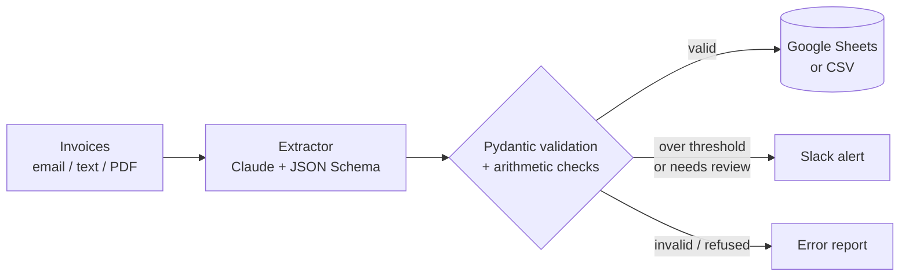

# AI Invoice Automation (demo)

> **Reference implementation / demo project.** It shows how I build AI workflow automations for clients. It is not client work.

Invoices arrive as emails, text or PDFs → **Claude** extracts vendor, date, line items and totals as **schema-validated JSON** → each row is appended to **Google Sheets** (or CSV) → a **Slack** alert fires for large invoices or ones where the numbers don't add up.


## The problem
Small finance and ops teams retype invoice data into spreadsheets by hand. It's slow and error-prone, and nobody notices when a vendor's subtotal doesn't match its line items.

## The solution
- **Structured extraction:** Claude (`claude-opus-5-5`) returns JSON constrained by a JSON Schema, which is then validated again with Pydantic. Malformed output never reaches the sheet.
- **Arithmetic checks:** line items are checked against the subtotal, and subtotal + tax against the total. Mismatches are flagged `needs_review`, never silently "fixed". (The bundled QuickPrint invoice has a real subtotal error. See the demo.)
- **Alerts:** a Slack webhook fires for totals over a threshold, or for any invoice flagged for review.
- **Safe failure:** refusals, truncated responses and invalid JSON are reported per file, and the batch keeps going.
- **Runs anywhere:** a CLI, a Docker image, and a CI pipeline that runs the whole flow in mock mode.

## Architecture


## Quickstart (one command, no API keys)
```bash
make install && make demo
```
This runs the full pipeline on the 3 bundled sample invoices, using recorded extractions (`samples/expected/`). Output goes to `out/invoices.csv`, and Slack alerts are printed instead of sent.

With Docker: `make docker-demo`

### Real mode
```bash
cp .env.example .env        # add ANTHROPIC_API_KEY (+ optional SLACK_WEBHOOK_URL, GOOGLE_SHEET_ID)
make run                    # or: .venv/bin/invoice-automation --input path/to/invoices
```
For Google Sheets, run `pip install -e '.[sheets]'`, share the sheet with a service account, and set `GOOGLE_SHEET_ID` + `GOOGLE_APPLICATION_CREDENTIALS`.

## Tests
```bash
make test   # 9 tests: validation, arithmetic checks, CSV + alerts, Claude request shape, error paths
make lint
```
CI (GitHub Actions) runs lint, tests, a mock end-to-end run, and a Docker build + run.

## How I'd adapt this for your business
- **Sources:** Gmail/Outlook inbox polling, a shared Drive folder, Dropbox, or an upload form
- **Destinations:** QuickBooks/Xero, your ERP or CRM, Airtable, Notion, or a Postgres database
- **Rules:** approval routing by amount or vendor, duplicate-invoice detection, PO matching
- **Ops:** scheduled runs (cron, Cloud Run jobs, n8n), retries, an audit log, and a weekly summary email
- **Other documents:** receipts, purchase orders, contracts, resumes or support emails. The same pattern works with a different schema.

## Contact
Need something like this for your workflow? Email **divyansh.sharma.swe@gmail.com** with what comes in, what should come out, and where it should go.

License: MIT
